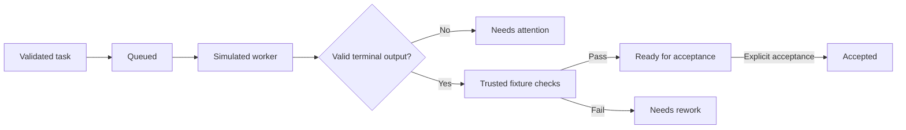

# XVANT

For the always-on autonomous project manager roadmap, read the [overall execution plan](docs/autonomy/README.md) and its detailed agent subplans.

Original local agent harness. Phase 2 adds durable SQLite state, supervised simulated workers, process checks, an authenticated loopback API, and verified snapshots. The default demos make no model calls; the explicitly approved OpenCode live probe below does.

## Run

Install Node **24.21.0** and npm **12.0.2**, then run from this directory:

```sh
npm ci --ignore-scripts
npm run demo
npm run demo -- quota
npm run demo:durable
npm run gate -- --phase 02 --offline
```

On this Windows workstation, an isolated Node binary is available. Use it for the current PowerShell session:

```powershell
$env:PATH = "$PWD/.tools/node_modules/node-win-x64/bin;$PWD/.tools/node_modules/.bin;$env:PATH"
node --version
npm run gate -- --phase 02 --offline
```

The local `.tools` directory is ignored and is not required on another machine. Use the pinned Node version there. If a managed Windows trust store is needed for package installation, set `NODE_USE_SYSTEM_CA=1`; certificate verification stays enabled.

## What Phase 1 does

- Validates task, attempt, worker, event, and evidence contracts with Zod.
- Keeps work revisions separate from state versions. Missing, failed, duplicated, or stale check receipts cannot approve work.
- Rejects duplicate worker IDs, aliases, and native session identities.
- Validates dependency DAGs independently of parent hierarchies: up to 20 nodes and three hierarchy levels. Lower limits are supported.
- Runs success, failure, delayed, malformed, quota, and unknown simulation scenarios.
- Reserves one turn per worker. A stream must obey task/attempt identity, event order, size limits, and one terminal outcome.
- Runs host-registered verification callbacks. Worker output cannot supply trusted receipts. Success reaches `ready_for_acceptance`; an explicit controller `accept` call is still required.
- Generates `docs/evidence/G01.json`, logs, a source manifest, suite counts, and coverage. Missing/skipped/failed tests fail the gate.



## Phase 2 and boundaries

`npm run demo:durable` executes a simulated worker in a child process, runs a host-registered process check, reopens the database, accepts persisted evidence, and verifies a backup/restore. Its temporary fixture is removed afterward. No listener or worker remains running.

Programmatic service entry: `startService(localStateDirectory, trustedChecks)` in `apps/controller/src/service.ts`. It returns the loopback origin, one-use bootstrap token, and a close method. The host delivers that token privately; never put it in a URL or log it. There is no UI yet.

Simulation hashes do not prove real code changes. Workspace IDs reserve logical resources; they do not isolate filesystem access. Restricted profiles fail closed: Windows taskkill/Linux process groups are not hostile-code containment. Unknown operations retain reservations until trusted reconciliation. Mixed live providers, subscriptions, Linux runtime qualification, and real repository attestation remain unverified.

Use local nonsynchronized storage. Snapshots restore into new directories only and preserve the controller lease TTL. Verify snapshots before recovering user data.

## Phase 3 offline foundation

`npm run probe -- --offline --runtime all` exercises ten synthetic provider
identities. `npm run probe -- --inventory-only --runtime all` reads CLI versions
without model calls. `npm run gate -- --phase 03 --offline` verifies the offline
foundation and all earlier suites. Those controllers reject live dispatch; this does not
complete the live Phase 3 milestone. See [adapter boundaries](packages/adapters/README.md).

## Phase 4 context and handoffs

Workers receive focused context through sealed packets, not raw transcripts.
`npm run gate -- --phase 04 --offline` runs every earlier suite and fixture plus the
Phase 4 suites and a handoff fixture. In that fixture, a Codex-named worker hands a
partly finished task to a Claude-named simulated worker in a separate process.
The recipient sees only the packet and must complete the task from it. No model
calls are made; the live handoff gate remains open.

- **Packets** (`packages/context/src/packet.ts`) carry the objective, acceptance
  criteria, revisions, recipient, write ownership, tools, skills and sourced items.
  The objective, criteria, policy and required items are never truncated: an
  oversized packet fails so the task can be split. Optional items enter whole by
  priority. Token counts are conservative byte-based estimates. Every packet has a
  hash seal that recipients verify.
- **Retrieval** (`retrieval.ts`) uses Git ignore rules (with repository fsmonitor
  programs disabled) or a bounded walk. It never opens secret-named files
  (`.env*`, keys, `.npmrc`, `.ssh/` and similar), drops credential-shaped content,
  refuses links, binary and oversized files, and ranks with SQLite FTS5.
  Detection is defense in depth, not a guarantee.
- **Memory** (`packages/storage/src/memory.ts`, schema v3) holds namespaced records
  with provenance. Workers can only propose, bound to their task's current
  attempt; acceptance, rejection and supersession are explicit. Reads are scoped
  to one project. Records anchored to files become stale when those files change
  (`packages/memory`), and stale, unaccepted, rejected or cross-project records
  never enter a packet.
- **Handoffs** (`handoff.ts`) copy requirements from the task record, keep exact
  revisions, remaining work, failed attempts, questions and artifact hashes, and
  make every fact a required packet item.
- **Inspection** (`inspect.ts`) explains why each candidate was included or
  omitted, without copying content.
- **Import and export** (`transfer.ts`) move accepted memory as sealed bundles.
  Imports become proposals, never accepted records. External transcripts are
  read without modification and stored as artifacts.

## Phase 5 tools and skills

`npm run gate -- --phase 05 --offline` runs everything through Phase 4 plus the
Phase 5 suites, a hostile-worker fixture behind the MCP bridge, the compatibility
report and a real-browser check. A host without a Chromium browser reports the
browser check as unavailable, which fails the gate rather than passing it.

- **Tools** (`packages/tools`): `file.read`, `file.apply_patch`, `repo.search`,
  `git.inspect`, `command.run`, `test.run`, `artifact.publish`,
  `agent.read_result`, `agent.request_work`, `memory.search`, `memory.propose`,
  `lessons.search` and `browser.inspect`. Every call passes one gate: the task catalog, the permission
  profile's effect classes, and for process actions an approval bound to the exact
  action hash. Results are schema-checked, size-capped and receipted. Workspace
  paths cannot escape, follow links, reach `.git` or secret files, or write outside
  owned paths. Patches name the hash they were based on. Git inspection never runs
  repository-configured programs. Commands never go through a shell.
- **MCP bridge** (`mcp.ts`): one authenticated loopback endpoint per task attempt
  exposes only that task's catalog to an external runtime.
- **Skills** (`skills/`, `packages/skills`): ten original skills with hashed
  instructions, exact-version dependencies, declarative hooks and fixtures. Skills
  cannot grant tools or permissions; selected skills are pinned by hash for the
  life of a task. Every fixture's check fails on the untouched repository and
  passes with its reference solution.
- **Native-tool bypass**: Codex, Claude Code and OpenCode run their own shell,
  edit and web tools outside XVANT. None of their restriction mechanisms is
  live-tested, so read-only profiles are blocked on them, and trusted-local needs
  an explicit acknowledgement. `node scripts/compatibility-report.mjs` prints the
  full skill × runtime × profile matrix.
- **Browser** (`browser.inspect`): a host-registered Chromium browser, a new
  temporary profile per call, loopback origins only, and every other request
  blocked through DevTools. This is defense in depth for trusted local pages, not
  a network sandbox.

## Lessons: a challenge/solution graph

Every orchestrated run records what went wrong and what fixed it, so later
work starts from what is already known instead of trying fixes blindly.
The graph lives in the same SQLite state (schema v5,
`packages/storage/src/lessons.ts`), scoped per repository: a run's lessons
are stored under `repo_<16 hex>`, a hash of the repository's normalized `origin`
URL (credentials, `.git` and case of the host ignored, so `git@host:a/b` and
`https://host/a/b` match), or of its Git common directory when there is no
remote, so clones with one origin and all worktrees of one repository share
lessons and other repositories never see them. The remote itself is never
stored. `RootSpec.lessonScope` overrides the scope; if it cannot be derived
the run uses its `projectId`. Lessons recorded before this under `cli` stay
readable with `--project cli`.

- **Nodes.** A _challenge_ is a failure XVANT met: a node's failing check or
  integration conflict, a failing combined check, or a review finding. Its
  identity is the failure's normalized first lines, so the same failure in a
  later run (other numbers, paths, hashes) updates the same node. A
  _solution_ is a change a worker made against one: its summary, files and a
  diff excerpt.
- **Edges.** `solved_by` when the host's checks passed on the change (or the
  next review approved it), `not_solved_by` when the same failure came back,
  and `followed_by` when fixing one challenge ran into another.
- **Reuse.** Before a repair turn, XVANT looks up the failure in the graph
  and adds a _Lessons from earlier work_ section to the prompt: fixes ranked
  by how often they worked and were verified, and approaches that did not
  work. Whether that repair then passes is fed back into the ranking, so
  suggestions that help rise and ones that do not sink. Workers can also query
  it themselves with the read-only `lessons.search` tool, and project memory
  with `memory.search`; every call is receipted. Workers on XVANT's own loop
  (`native-local`) have both in their catalog, and Codex, Claude and OpenCode
  turns reach them through a task-scoped MCP bridge that serves only those two
  tools. `lessons.search` always reads the scope the run writes to, chosen by
  the host and not by tool input, so a worker never sees another repository's
  lessons; `lessons: false` turns it off for the run.
- **Trust.** Only the host writes the graph. A solution counts as verified
  only for checks the host ran; its summary is the worker's own account.
  `xvant run` and the app run no checks on a node alone, so a node repair is
  recorded unverified first. When the combined checks then all pass on the
  integrated result, the repairs of that run are marked as verified by the
  checks that passed; if they fail, or there are none, they stay unverified.
  Lessons enter prompts marked as sourced data, not instructions, and stored
  text has credential-shaped strings removed. Turn it off per run with
  `lessons: false` in the root spec.
- **Are they helping?** Each run stores, in its state (`state.lessons`), its
  lesson scope and how its repair turns went, split by whether the repair prompt
  carried lessons: `repairs: { hinted: {passed, failed}, unhinted: {passed,
failed} }`. Repairs are node repairs, combined-check fixes and review fixes; a
  node's first attempt is not a repair. A repair is judged by the same rules that
  feed the ranking: an unknown or cancelled turn, a runtime failure, an operator
  stop and a review that gave no verdict are not judged. `xvant run` and
  `xvant status ID` end with one line, e.g. `Lessons: 2 challenges, 1 fix
recorded, repairs hinted 1/1 passed, unhinted 0/1 passed`, left out when
  lessons were off or nothing happened. `lessons stats` adds the runs of the
  scope up (the newest 200, filtered in the database; runs stored before scopes
  were recorded are not counted) and prints the raw counts, the pass rate of
  each group, judged repairs per run, the most helpful fixes and the challenges
  seen often with no verified fix. With fewer than 5 judged repairs in either
  group it says the sample is too small to compare. The groups are not
  randomized (hinted repairs are the ones whose failure was seen before), so a
  gap is a lead and not proof.
- **Forgetting.** `lessons forget ID --reason TEXT` is a soft delete for a
  challenge or a solution. The node stays in the graph for audit, marked
  `forgotten: {at, reason}` in its body, but it is never matched: not by
  `lessons.search`, not in a prompt, not as a fix or a dead end. Seeing the
  same failure again, or recording the same change again, does not bring it
  back. `list` and `export` hide forgotten nodes unless `--all`; `show` prints
  the mark.
- **Size cap.** A scope keeps at most 2000 live nodes (`DEFAULT_LESSON_CAP`;
  `lessonCap` in the `Store` options). Recording past it, in the same
  transaction, prunes about a tenth below the cap: least useful first (no
  verified solution or successful reuse; a solution nothing links to counts
  for nothing), then oldest. The node just written is never pruned. Pruning
  deletes the node, its edges and its search text. Forgotten nodes neither count
  toward the cap nor get pruned, so they cannot crowd out live lessons. Under
  the cap a write only counts rows.

Read it with the CLI. With no `--project`, it reads the scope of `--repo PATH`,
else of the current directory, else the legacy project `cli`:

```sh
npm run xvant -- lessons                      # challenges, newest first
npm run xvant -- lessons --repo ../other-repo  # another repository's lessons
npm run xvant -- lessons search "expected 42, got 41"
npm run xvant -- lessons show ch_354d7a4a2e0a6dbe
npm run xvant -- lessons stats                # hinted vs unhinted repairs, raw counts
npm run xvant -- lessons stats --format json
npm run xvant -- lessons forget ch_354d7a4a2e0a6dbe --reason "fix was wrong"
npm run xvant -- lessons list --all           # include forgotten nodes
npm run xvant -- lessons export               # Markdown document
npm run xvant -- lessons export --format mermaid   # paste into any Mermaid viewer
npm run xvant -- lessons export --format json
```

The local app (`xvant ui`) has a **Lessons** view for the same data. Pick one
of the repositories the app has run work in (the server maps it to its scope; a
scope or an unknown folder is refused). It lists the challenges, newest first,
each expanding to its fixes and dead ends with the summary, files, whether it
is verified, usage counts and a diff excerpt, then the `lessons stats` report
(raw counts and the sample-too-small note) and the Mermaid source as copyable
text; no diagram renderer is bundled. All of it is shown as text, since it
derives from worker output. Forgotten nodes are hidden. A **Forget** button on
a challenge, fix or dead end needs a reason and a confirmation, and does what
`lessons forget` does. The API is `GET /api/v1/lessons/repositories`,
`GET /api/v1/lessons?repository=PATH` and `POST /api/v1/lessons/forget`.

## Layout

| Path                              | Responsibility                                      |
| --------------------------------- | --------------------------------------------------- |
| `packages/contracts`              | Validated boundary schemas and typed errors         |
| `packages/core`                   | Pure transitions, evidence consistency, graph rules |
| `packages/adapters/src/simulated` | Deterministic simulation and fault fixtures         |
| `packages/context`                | Packets, retrieval, handoffs, inspection, transfer  |
| `packages/memory`                 | Memory freshness, packets, lesson rendering         |
| `packages/tools`                  | Tool registry, tools, MCP bridge, browser           |
| `packages/skills`                 | Skill catalog, pinning, hooks, compatibility        |
| `skills`, `fixtures/skills`       | Original skills and their evaluation fixtures       |
| `apps/controller`                 | In-memory orchestration and runnable demo           |
| `scripts`                         | Offline gate and test-report validation             |
| `tests`                           | Gate-policy tests                                   |
| `docs/evidence`                   | Compatibility decisions and gate results            |

Run `npm test`, `npm run typecheck`, `npm run lint`, or `npm run format:check` for individual checks. Run the gate on each host to qualify that host.

## Durable OpenCode live integration

`LiveOpenCodeController` supports explicitly approved, trusted-local text turns with OpenCode **2.0.19** and **opencode/big-pickle**. It journals native session creation before spawning the CLI, atomically reserves the returned session ID, journals inference, validates the JSON stream, runs host-registered checks against stable workspace snapshots, and prepares evidence for explicit acceptance. Accepted sessions can resume within the same project, workspace, host, and account. Recovery retains uncertain reservations and never replays a prompt automatically.

Run the opt-in qualification with the installed executable:

```powershell
npm run probe:live:opencode -- --approve-live --executable "<path-to-opencode.exe>"
```

Replace `<path-to-opencode.exe>` with the full path to your installed OpenCode CLI binary.

This runs two real model turns, checks token recall on the same native session, reopens SQLite before each explicit fixture acceptance, and writes `docs/evidence/G03-opencode-live.json`. State and workspace artifacts remain under `.artifacts/opencode-live-*`. No paid fallback is configured. This provider-specific receipt does not complete the mixed-provider live G03 milestone.

The CLI inherits standard OpenCode configuration and permissions; it is not sandboxed. No automatic permission approval is supplied. Tool events and unknown output fail the text protocol, but rejecting an event cannot undo a tool already run. Use only trusted local workspaces. A controller permits one active run at a time. Interrupts, timeouts, and uncertain shutdown retain reservations for trusted reconciliation. The HTTP and offline fixture controllers remain separate and cannot qualify live evidence.
