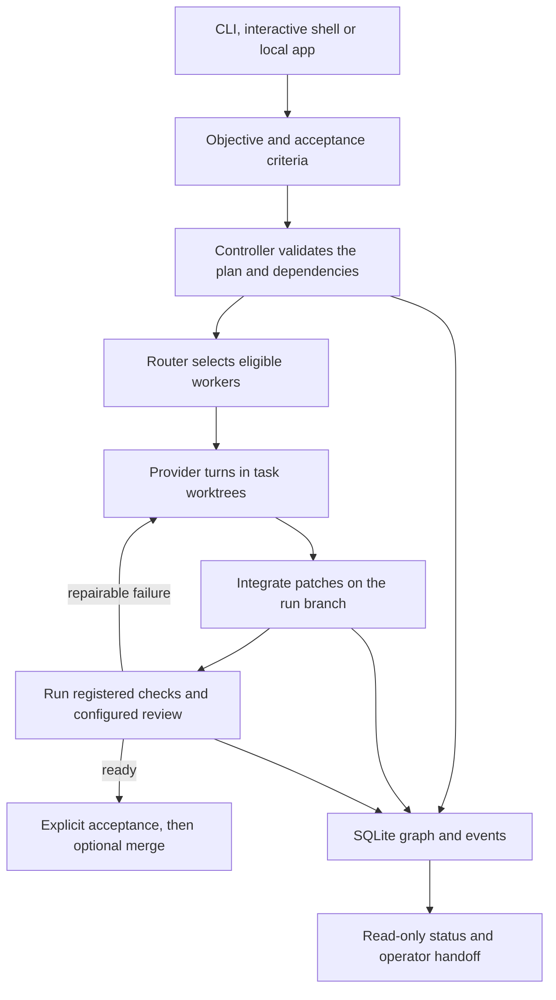

# Firstmate, xvant and xvant-agent

Firstmate coordinates agents across projects. The xvant skill kit guides decisions inside a Claude Code session. The xvant-agent runtime owns the execution and evidence for a run. Their points of contact are the task brief, the evidence a worker returns and the state a new session needs to continue.

This comparison covers the architecture of Firstmate at `427056c`, xvant at `0690a6a`, and xvant-agent at `68d36e1`, plus the inspection and handoff changes described below. Source links identify the reviewed versions. Runtime support varies by provider and host.

## Firstmate from request to recovery

| Component | Responsibility |
| --- | --- |
| Primary session | A terminal coding agent loads the role and authority rules from `AGENTS.md`. It resolves the user's project, consults the project registry and backlog, and serves as the crew's contact with the user. Startup reconciles disk records with the actual backend sessions. |
| Brief and routing | `fm-brief.sh` scaffolds a brief that distinguishes user intent from implementation instructions. A scout returns a sourced investigation report. A ship task changes the project. Dispatch resolves the harness, profile, account, backend, base branch and delivery authority as applicable. |
| Worker execution | `fm-spawn.sh` launches a worker in an isolated Git worktree. The harness runs the agent. The session backend supplies the visible endpoint, such as a tmux window or Herdr tab. Parallel tasks can operate on different revisions of the same repository. |
| Communication | A steer is recorded in a task inbox. The terminal gets a notification to read it. Acknowledgment and decision records let the supervisor distinguish sending a request from receiving an answer. Interrupt, exit and relaunch have their own lifecycle commands. |
| Supervision | A Bash watcher interprets worker signals, waits and stale sessions. An actionable event wakes the lead agent. Harness-specific hooks or supervision hosts keep the watch active across turns. Quiet and away modes control who handles wakeups and how pending decisions reach the user. |
| Delivery | A ship task follows its selected path: a full validation pipeline, a direct pull request, or a guarded local landing. Merge authority is a separate decision. Cleanup checks for unlanded work. A scout preserves its report and surfaces outstanding decisions before teardown. |
| Persistence | A Firstmate home keeps project registrations, briefs, reports, preferences, operational lessons and runtime state on disk. Events tell the supervisor what to investigate. Live backend state and durable records establish what can safely resume. |
| Fleet extensions | A secondmate has its own charter, home, lock, backlog and workers, locally or over SSH. Relay can route opted-in external mentions. Fleet ledgers expose activity, while guarded sync and update procedures refresh clones and the supervisor installation. |
| Operator skills | Bearings summarizes the fleet. Ahoy surfaces decisions. AFK and Quiet change supervision posture. Stow captures open work and curates durable memory. The URL review skill routes annotated feedback. Updatefirstmate coordinates upgrades and restarts. Internal skills load on demand. The public standalone Stow works outside the fleet. |

Follow a task through the [supervisor contract](https://github.com/kunchenguid/firstmate/blob/427056c/AGENTS.md), [architecture](https://github.com/kunchenguid/firstmate/blob/427056c/docs/architecture.md), [configuration](https://github.com/kunchenguid/firstmate/blob/427056c/docs/configuration.md) and [built-in skill index](https://github.com/kunchenguid/firstmate/blob/427056c/README.md#built-in-skills).

## The xvant skill kit

The repository includes 33 workflow skills plus the index. Each skill owns a trigger and can expose modes within that trigger. Shared procedures live under `_shared/`. Some deeper procedures refer to other installed skill sources. Installing the kit and running the TypeScript harness are separate operations.

| Moment | Skills and responsibility |
| --- | --- |
| Shape the work | Brainstorm explores the idea. Plan, plan-review and to-work turn it into an actionable scope. Intent runs an interview followed by a hands-off build. Hackathon handles a judged, time-boxed build. |
| Implement | TDD, execute, worktree, debug and prototype guide tests, planned execution, isolation, diagnosis and exploratory builds. Execute can dispatch independent tasks with a shared brief format. |
| Verify | Verify owns the completion trigger. It sequences runtime checks, review, security and simplify. Review-exchange handles giving and receiving feedback. Review can use four specialist reviewer personas and a verifier. |
| Deliver and maintain | Ship handles integration or release. Release-guard and repo-guard cover operational and repository safeguards. Architecture examines module boundaries. |
| Configure and create | Write-skill, extend, configure and claude-md maintain the agent environment. Design, browse, docs and second-brain cover interface work, browser tasks, documents and knowledge capture. |
| Continue across sessions | Handoff produces a machine-facing resume file. Retro records human-facing lessons. Study, schedule and caveman handle learning, recurring tasks and response style. |

The trigger rules and source dependencies are in the [skill registry](https://github.com/Azrkiel/xvant/blob/0690a6a/xvant-INDEX/SKILL.md). The [verification workflow](https://github.com/Azrkiel/xvant/blob/0690a6a/xvant-verify/SKILL.md) and [handoff template](https://github.com/Azrkiel/xvant/blob/0690a6a/xvant-handoff/SKILL.md) show how the kit defines completion and continuity.

## The xvant-agent runtime

| Subsystem | Responsibility |
| --- | --- |
| Entry points and controller | The CLI, shell and local app start and inspect runs. The orchestrator validates supplied or proposed plans, checks dependencies and write scopes, schedules work, performs bounded repairs, and records the integrated result. |
| Runtime selection and execution | The router checks roles, availability, runtime preferences and model tiers. Adapters translate native runtime events. The supervisor manages processes, interrupts and uncertain outcomes. XVANT's native loop also supports a local model endpoint. |
| Storage and verification | SQLite holds graph revisions, task states, event history, leases, reservations and receipts. The object store holds artifacts. Host checks bind evidence to work. Worktrees isolate edits, and integration uses a separate branch. The CLI checks repository and revision identity before acceptance and merge. |
| Context and memory | Sealed packets carry task requirements, tool access, source provenance and ownership. Worker-to-worker handoffs retain facts and questions. Project-scoped memory supports proposals and freshness checks. The lessons graph connects failures to attempted and verified fixes. |
| Tools and skills | A task-scoped MCP bridge exposes the approved catalog. Ten bundled runtime skills have manifests, pinned versions and fixtures. The external Claude Code skill kit has its own installation and trigger conventions. A third-party runtime's native tools have a separate enforcement boundary. |
| Operations and evaluation | The local app streams events. The CLI supports backup, restore, branch sharing and lesson inspection. Benchmarks, routing profiles, offline fixtures and provider-specific probes measure different capabilities. Live qualification is specific to the tested combination of host, runtime and operation. |

Primary sources include the [orchestrator](https://github.com/Azrkiel/xvant-agent/blob/68d36e1/apps/controller/src/orchestrator.ts), [router](https://github.com/Azrkiel/xvant-agent/blob/68d36e1/packages/core/src/router.ts), [CLI](https://github.com/Azrkiel/xvant-agent/blob/68d36e1/scripts/xvant.mjs), [runtime skills](https://github.com/Azrkiel/xvant-agent/tree/68d36e1/skills) and [project phase record](https://github.com/Azrkiel/xvant-agent/blob/68d36e1/plan.md).

## What transfers to XVANT

| Firstmate practice | Decision for XVANT |
| --- | --- |
| Inspect the fleet while the lead works | Implemented read-only CLI status against a consistent SQLite snapshot. Previously, the observer opened a writer Store and could encounter the live controller's lease. |
| Resume from a durable task record | Implemented a run-level JSON handoff. It includes the graph version, objective, acceptance criteria, recorded worker state, blockers, checks, review and integration revision. A new operator can reread that run ID. Live worker liveness still requires a controller check. |
| Reconcile on startup | The new run controller marks interrupted graphs and running nodes as needing attention as it acquires the writer lease. A durable event records the prior phase. Worktrees, attempts and existing evidence remain available for inspection. Verification, review and repair also record phase starts before doing the work. |
| Separate intent, investigation and delivery | The companion skill changes extend the shared dispatch brief with original intent, assumptions, expected report or change, owned paths and checks. The existing handoff skill can cite a known runtime snapshot alongside Git evidence. These are prompt-level conventions in the kit. |
| Visible terminal sessions | XVANT already has observable execution through its shell, local app and event stream. Launching interactive tmux workers would require a backend adapter with process identity, interruption and recovery semantics across supported hosts. |
| Durable mid-run steering | Firstmate tracks incoming steers and their acknowledgment. A future XVANT implementation would need a versioned command addressed to a specific run and attempt, plus a controller rule for applying or rejecting it. The snapshot added here provides observation only. |
| Remote supervisors, external channels and autonomous landing | Cross-host execution and external message delivery introduce new identity, transport and recovery requirements. This change uses XVANT's existing single-writer model and explicit accept/merge path. |

For example, when a worker stops during a repair, a second terminal can read the last committed graph, record the blocker and revision in a handoff, and leave the decision to reconcile or retry with the operator. This works even while the app still owns the database lease.
