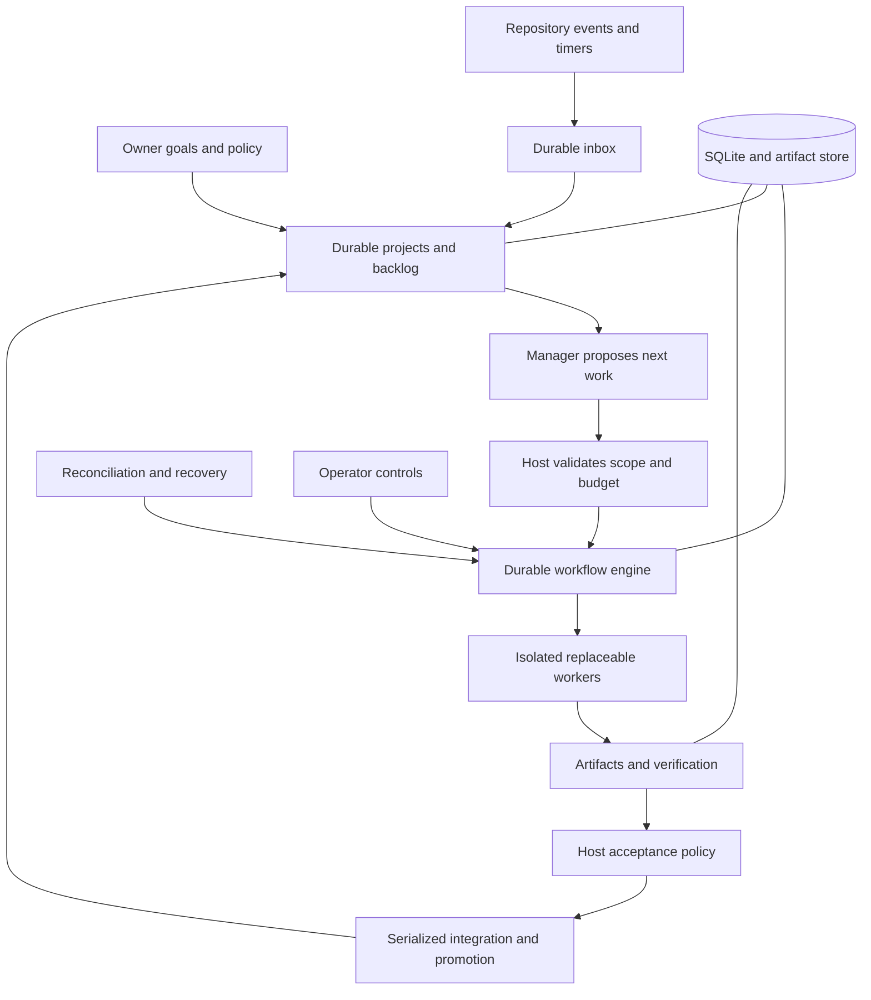

# XVANT autonomous project manager: execution plan

Status: proposed execution roadmap; implementation has not started under this plan.
Plan version: 1.0, 2026-11-12. Baseline: `68d36e123394002fd9ff5825c3c382745892e3b6`.

## Mission

Build an always-on project manager that accepts an objective and operating boundaries, maintains a backlog, directs subagents, verifies their results, integrates qualifying changes, and continues across process failures and host restarts. It should finish authorized work without routine intervention, or identify a specific, actionable blocker. It should remain idle when there is no useful authorized work.

Persistence belongs to project state and the service. Model conversations and workers are replaceable. Correctness means that state, authority, evidence, and externally visible effects obey explicit contracts. No architecture guarantees that arbitrary generated code satisfies an ambiguous human intention; acceptance checks and live outcome evaluation must address that uncertainty honestly.

The initial unattended deployment target is one continuously available Linux host, one authoritative controller, SQLite on local durable storage, and a bounded pool of isolated workers. Design for several projects, but qualify one repository first. Preserve supported Windows workflows and report their qualification separately. Distributed controllers, unrestricted self-modification, arbitrary autonomous spending, and general production deployment are outside the first release.

## How an implementation agent should use this plan

Read this file and the assigned subplan in full. Those two documents define the task; follow source links as needed. Inspect the current implementation before editing: this baseline will age. A listed path is a starting point, not a required destination for new code.

1. Check prerequisite outcomes against code and evidence, not a checkbox alone. If they are missing, implement an independently useful slice or report the exact dependency; do not claim downstream completion using mocks alone.
2. Record a short implementation approach, acceptance-criterion IDs, affected interfaces, migration implications, and intended validation.
3. Work in a separate implementation branch. Make coherent, reviewable changes. Coordinate changes to shared contracts before dependent work proceeds.
4. Meet the common invariants below and every acceptance criterion in the assigned subplan. Add behavior tests that detect the failure being addressed. Exercise restart boundaries in real processes where relevant.
5. Run the relevant checks and required repository gate. Publish a concise handoff with source revision, commands, outcomes, evidence locations, limitations, and next task. Preserve failed-run evidence when it explains a defect or environmental issue.
6. Update the execution ledger and any affected interface or design decisions. Mark partial work as partial. Do not mark a milestone complete because its happy path passed.

Suggested invocation:

```text
Implement subplan A02 for XVANT.
Read docs/autonomy/README.md and docs/autonomy/02-durable-workflow.md.
Inspect current code and prerequisite evidence. Implement the task, validate every
A02 acceptance criterion, and provide the required handoff. Use your judgment on
implementation design within the plan's invariants and authorized task scope.
```

## Creative latitude and decision rules

Agents are encouraged to improve decomposition, interfaces, algorithms, fixtures, operational ergonomics, and implementation order within a milestone. They may replace a proposed design with a simpler or better-supported one, split a milestone into several PRs, and fix adjacent defects necessary to make the deliverable reliable. Avoid permission requests for ordinary implementation decisions already covered by the assigned task.

Outcomes and invariants are binding; suggested APIs, file layout, schemas, and individual PR boundaries are design guidance. Explain material deviations in a decision record: problem, alternatives, chosen approach, invariant impact, evidence, migration, and rollback. Keep such records under `docs/autonomy/decisions/` when needed.

Do not redefine success after seeing results, remove difficult tests to pass, broaden operational authority, discard uncertainty, or silently weaken acceptance, isolation, budgets, or review independence. If a required outcome conflicts with evidence or is infeasible, document a concrete replacement proposal and leave that outcome explicitly unresolved. Owner decisions are needed for new authority, materially changed product scope, or unavoidable destructive operations—not routine engineering choices. Existing session authorization takes precedence over this workflow.

## Starting position

The baseline includes contracts, fenced SQLite transactions, provider journals, immutable artifacts, worktrees, DAG validation, routing, repair loops, host verification, explicit acceptance, a local UI, project memory, and a lessons graph. PRs #5–#9 are integrated. The baseline's offline G10 passed 31 checks and 1,428 tests on Linux using Node 24.21.0 and npm 12.0.2. This is historical verification, not qualification of future changes or unattended live operation.

Key gaps observed in the baseline:

- `apps/controller/src/orchestrator.ts` constructs a fresh root graph and maintains execution counters and sets in memory. It lacks a complete root-workflow resume path.
- `packages/storage/src/work-graphs.ts` stores graph snapshots and events, but not a fully versioned executable specification and durable action queue.
- Recovery in `packages/storage/src/providers.ts` preserves uncertainty; it does not automatically investigate all outcomes and continue a project.
- `ready` means ready for a human decision; a rejected review may still reach it. Empty checks are permitted and a no-op check can serve a worker turn. Neither implies autonomous verification.
- Provider session resume and the native loop checkpoint do not constitute end-to-end project resume.
- Worktrees and MCP permissions do not contain native shell, edit, or network tools running outside the bridge.
- The repository has benchmark and release machinery, but the referenced historical evidence and runbooks are not all published with the source.

## Architecture and ownership



The manager proposes priorities, plans, and repairs. The host alone admits work, grants capabilities, records authoritative state, evaluates acceptance, and performs promotion. Workers return proposals and artifacts. Reviewers provide evidence, not unilateral acceptance authority. The service owns execution; CLI/UI clients submit authenticated commands. Provider adapters own protocol handling, not project truth.

Prefer extending the current contracts, storage, adapters, policy, and evaluation packages. Extract the orchestrator incrementally, with legacy behavior covered during migration. A pure transition function plus a durable effect dispatcher is the recommended structure; alternatives must demonstrate equivalent recovery and authority guarantees.

## Common invariants

- **I01 — Authority:** model text, retrieved memories, repository instructions, and tool outputs cannot grant permissions or change acceptance policy. Untrusted text remains sourced data.
- **I02 — Durable intent:** commit state changes and action intents transactionally before dispatch. Persist stable command, operation, attempt, and result identities.
- **I03 — Ownership:** stale controllers and workers cannot commit results or promote changes. Fence database writes and enforce ownership at effect boundaries; a database token alone does not fence a remote API.
- **I04 — Uncertainty:** timeouts and lost responses are not proof of failure or success. Retain reservations until evidence establishes a safe next action. Never blindly replay an uncertain external effect.
- **I05 — Evidence:** acceptance binds the exact candidate revision, requirements, policy version, verifier definitions, and required review. A changed dependency invalidates affected evidence.
- **I06 — Isolation:** no cross-project workspace, credential, memory, or resource access outside the granted capability. Native tools require an enforced execution boundary.
- **I07 — Budgets:** dispatch reserves resources durably. Retries, child tasks, and restarts cannot reset limits or expand parent authority.
- **I08 — Accountability:** explain every terminal outcome, block, retry, replan, and promotion. Deduplicate incoming commands and external events.
- **I09 — Honest completion:** missing checks, unknown outcomes, rejected required reviews, and partial evidence cannot satisfy autonomous completion. Manual overrides are explicit, scoped, and audited.
- **I10 — Bounded progress:** authorized runnable work is eventually scheduled under available resources; repeated failures stop within policy; completed or idle projects generate no unbounded work.

SQLite and Git cannot share a transaction. Persist intents and reconcile observable commits. Target deduplicated logical acceptance and verified effects, not an impossible universal exactly-once promise for arbitrary external commands.

## Milestones and dependency order

All milestones begin **planned**, with no implementation claim. Each subplan contains its own acceptance criteria and handoff requirements.

| ID  | Subplan                                                        | Prerequisites for completion | Primary outcome                                   | Status / implementation / evidence      |
| --- | -------------------------------------------------------------- | ---------------------------- | ------------------------------------------------- | --------------------------------------- |
| A00 | [Baseline and CI](00-baseline-and-ci.md)                       | None                         | Reproducible checks and retained evidence         | Planned; no implementation evidence yet |
| A01 | [Project and autonomy contracts](01-project-contracts.md)      | A00                          | Executable authority and completion rules         | Planned; no implementation evidence yet |
| A02 | [Durable workflow engine](02-durable-workflow.md)              | A01                          | Reconstruct and advance a persisted run           | Planned; no implementation evidence yet |
| A03 | [Recovery and reconciliation](03-recovery.md)                  | A02                          | Resolve interrupted effects safely                | Planned; no implementation evidence yet |
| A04 | [Daemon and scheduler](04-daemon-and-scheduler.md)             | A03                          | Continuous service and durable scheduling         | Planned; no implementation evidence yet |
| A05 | [Project manager](05-project-manager.md)                       | A04                          | Multi-milestone planning and bounded delegation   | Planned; no implementation evidence yet |
| A06 | [Isolation and budgets](06-isolation-and-budgets.md)           | A01, A02                     | Enforceable worker boundaries and resource limits | Planned; no implementation evidence yet |
| A07 | [Verification and promotion](07-verification-and-promotion.md) | A03, A06                     | Policy-controlled autonomous integration          | Planned; no implementation evidence yet |
| A08 | [Events and integrations](08-events-and-integrations.md)       | A04, A05, A07                | Reliable external work intake and delivery        | Planned; no implementation evidence yet |
| A09 | [Project memory and learning](09-memory-and-learning.md)       | A01, A05                     | Useful, scoped, evidence-aware memory             | Planned; no implementation evidence yet |
| A10 | [Operator experience and operations](10-operations.md)         | A04, A06, A07                | Operable service, recovery, and upgrade lifecycle | Planned; no implementation evidence yet |
| A11 | [Qualification and release](11-qualification.md)               | A00–A10                      | Demonstrated reliability and useful autonomy      | Planned; no implementation evidence yet |

Work can overlap after interfaces are agreed: A06 can proceed alongside A03–A05; A09 alongside A07–A08; early observability from A10 should accompany A04. Completion still requires prerequisite outcomes. Avoid simultaneous uncoordinated edits to shared storage migrations or acceptance contracts.

Execution sequence:

1. Establish CI and the completion contract, then persist a complete run specification.
2. Extract transitions and durable dispatch; add reconciliation before automatic restart.
3. Demonstrate daemon restart and a persistent project manager with synthetic workers.
4. Complete isolation, budgets, and trusted verification before enabling unattended live work.
5. Add external events, memory, operator controls, and recovery operations.
6. Qualify a narrow live profile, then expand only with recorded evidence.

## Release definition and reference demonstration

The first release is an autonomous repository-maintenance and bounded feature-development service within an owner-configured scope. It can plan, execute, verify, and integrate approved classes of work without routine human confirmation. Deployment authority is separate and optional. Human intervention is appropriate for unresolved ambiguity, required authority, invalid credentials, and exhausted budgets; these must be actionable blocks, not silent hangs.

Reference demonstration: assign a small project with at least three dependent milestones, a parallel implementation opportunity, a failing acceptance check, and a subsequent repair. Interrupt a worker and restart the controller during the project. Change the target branch before promotion. XVANT recovers, reevaluates stale evidence, completes authorized integration, records its decisions, selects the next milestone, and finally becomes idle. Include a second scenario whose ambiguous external effect must remain blocked rather than be duplicated.

Release requires: all milestone criteria evidenced; mandatory fault cases accounted for; zero observed lost committed tasks, duplicate logical promotions, stale-evidence acceptances, or boundary violations in the declared qualification campaign; successful restore and upgrade drills; and repeated live comparisons reporting completion, escaped defects, usage, latency, and interventions. Zero observed violations in a finite campaign is evidence, not a universal guarantee.

## Common validation and handoff

Use the repository's pinned toolchain. At this baseline the full offline command is `npm run gate -- --phase 10 --offline`; future automation may replace its implementation but must retain meaningful coverage and evidence. Run focused checks during development and the required integrated gate before declaring an implementation milestone complete. Documentation-only changes require formatting and link validation, not a model campaign. Never label a fixture pass as a live provider pass.

On Linux containers, use a real init/subreaper for process-death tests. The baseline container's PID 1 did not reap orphaned children; changing test expectations to ignore running descendants is not an acceptable substitute. Browser checks require Chromium and release-signing fixtures require the OpenSSH client. Record runtime versions and host constraints.

Every implementation handoff must include:

```text
Milestone / scope:
Implementation commit and prerequisite commits:
Acceptance criterion ID -> command or artifact -> result:
Source/evidence hashes and runtime/host versions:
Changed interfaces and migration/rollback procedure:
Design deviations and rationale:
Remaining risks, unsupported cases, and blockers:
Next recommended task:
```

Store durable decision/handoff records under this directory or publish stable links to CI artifacts. Keep sensitive prompts, credentials, and user data out of public evidence. Evidence must remain identifiable after temporary CI artifacts expire. Add implementation commit and evidence links to the milestone row when work completes; an agent starting later must still verify that the current tree preserves those outcomes.
