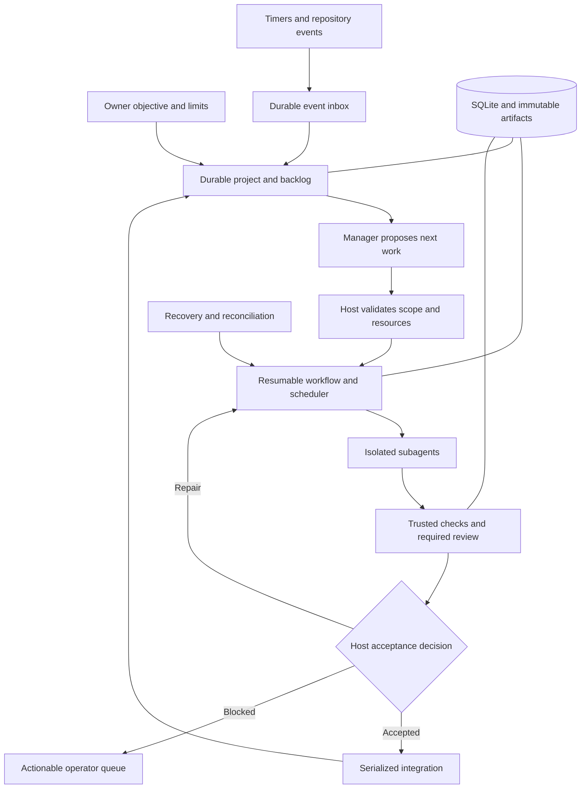

# XVANT: build an autonomous, persistent project manager

Version 2.0 — clarity and execution rewrite, 2026-11-12.
Status: implementation underway; the milestone table records observed outcomes.
Uncompleted milestones remain plans, not implementation claims.
Code baseline reviewed: `68d36e123394002fd9ff5825c3c382745892e3b6`.

## 1. What we are building

Give XVANT a project objective, acceptance criteria, and operating limits. It should:

1. Maintain a prioritized backlog and decide what to work on next.
2. Break work into bounded tasks and assign suitable subagents.
3. Check the results, repair failures, and integrate qualifying changes.
4. Recover after a worker, controller, or host stops.
5. Continue until the agreed objective is satisfied, then become idle.
6. Ask for help only when a specific missing decision, permission, resource, or unresolved outcome prevents progress.

The project persists in the database; individual model sessions are replaceable. Correctness comes from explicit requirements, enforceable permissions, and evidence about the actual result. Passing tests does not prove every possible interpretation of a vague objective.

Start with one always-on Linux host, one authoritative controller, SQLite on local durable storage, and a bounded worker pool. Qualify one repository first while keeping project identities separate. Preserve existing supported Windows behavior; qualify unattended Windows operation separately. Distributed controllers and general autonomous production deployment come later, if needed.

## 2. What exists and what needs to change

The reviewed baseline already has provider adapters, SQLite state, events, worktrees, plan validation, worker routing, repair loops, host verification, a local UI, memory, and lessons. Its offline gate passed 31 checks and 1,428 tests; that historical result does not qualify the architecture proposed here.

| Existing behavior                                            | Required next behavior                                                                     |
| ------------------------------------------------------------ | ------------------------------------------------------------------------------------------ |
| One invocation creates and runs a root plan                  | Load a persisted run and advance its next legal step                                       |
| Progress is saved, but execution also uses in-memory state   | Persist all inputs, assignments, counters, pending actions, and decisions needed to resume |
| Unknown outcomes are retained for attention                  | Investigate them and continue only when the outcome is established                         |
| The local app owns active execution in memory                | A daemon owns durable queues and execution independently of clients                        |
| A planner decomposes one root task                           | A manager maintains milestones and a backlog across many runs                              |
| `ready` allows a person to decide, including after rejection | Autonomous acceptance requires an explicit evidence/policy decision                        |
| Worktrees separate edits; native tools may bypass the bridge | Enforce filesystem, network, credential, and resource boundaries around workers            |

Inspect the current source before editing. Reuse existing storage, contracts, adapters, and verification rather than rebuilding them without a demonstrated need.

## 3. The architecture to implement

The manager proposes plans, priorities, and repairs. The host decides what may execute, owns authoritative state, and evaluates completion. Workers return artifacts and observations. Reviewers contribute evidence. The daemon owns execution; the CLI and UI are clients.

Prefer small deterministic state transitions plus a durable dispatcher for external actions. An equivalent design is welcome if it demonstrates the same guarantees. SQLite and Git do not share a transaction: record intent, perform the action, and reconcile any gap using observable evidence.

## 4. Build in five stages

| Stage                          | Milestones         | Demonstration required before moving on                                                            |
| ------------------------------ | ------------------ | -------------------------------------------------------------------------------------------------- |
| 1. Establish the rules         | A00, A01           | Reproducible checks and a deterministic completion/admission contract                              |
| 2. Survive interruption        | A02, A03           | Stop a run between steps; reconstruct it without losing or blindly repeating work                  |
| 3. Deliver the autonomous core | A04, A05, A06, A07 | A background manager delegates, repairs, verifies, and integrates a small project within policy    |
| 4. Make it useful to operate   | A08, A09, A10      | External events, current project knowledge, understandable controls, backup and upgrade procedures |
| 5. Qualify the release         | A11                | Recorded fault campaigns, unattended operation, and honest comparisons with a single agent         |

A06 can proceed alongside A03–A05 after its prerequisites are met. Build basic observability with the daemon. Do not enable unattended live workers before isolation and autonomous acceptance are qualified. Fixtures allow earlier development without claiming live readiness.

## 5. Assignable subplans and progress

Read this document and the assigned subplan. Each subplan identifies the first useful change, subsequent work packages, success criteria, and concrete test scenarios.

| ID  | Subplan                                                          | Completion prerequisites | Status / implementation / evidence                                                                                                                             |
| --- | ---------------------------------------------------------------- | ------------------------ | -------------------------------------------------------------------------------------------------------------------------------------------------------------- |
| A00 | [Reproducible checks and CI](00-baseline-and-ci.md)              | None                     | Complete: [implementation / PR #10](https://github.com/Azrkiel/xvant-agent/pull/10), [criterion evidence](../evidence/a00/handoff.md), [runner](a00-runner.md) |
| A01 | [Project and completion contracts](01-project-contracts.md)      | A00                      | Planned                                                                                                                                                        |
| A02 | [Resumable workflow](02-durable-workflow.md)                     | A01                      | Planned                                                                                                                                                        |
| A03 | [Recovery and reconciliation](03-recovery.md)                    | A02                      | Planned                                                                                                                                                        |
| A04 | [Daemon and scheduler](04-daemon-and-scheduler.md)               | A03                      | Planned                                                                                                                                                        |
| A05 | [Persistent project manager](05-project-manager.md)              | A04                      | Planned                                                                                                                                                        |
| A06 | [Isolation and budgets](06-isolation-and-budgets.md)             | A01, A02                 | Planned                                                                                                                                                        |
| A07 | [Verification and integration](07-verification-and-promotion.md) | A03, A06                 | Planned                                                                                                                                                        |
| A08 | [Events and integrations](08-events-and-integrations.md)         | A04, A05, A07            | Planned                                                                                                                                                        |
| A09 | [Memory and lessons](09-memory-and-learning.md)                  | A01, A05                 | Planned                                                                                                                                                        |
| A10 | [Controls and operations](10-operations.md)                      | A04, A06, A07            | Planned                                                                                                                                                        |
| A11 | [Qualification and release](11-qualification.md)                 | A00–A10                  | Planned                                                                                                                                                        |

**Start with A00, work package 1: reproduce the full offline gate on a clean runner and document its actual requirements.** Then automate that same setup. A00 does not require implementing the daemon or changing orchestration.

Prerequisites describe working outcomes, not just merged documents. Design dependent interfaces early where useful, but do not declare a dependent milestone complete using mocked prerequisites. Keep this table current with implementation commits and evidence links. Use planned, in progress, blocked, or complete; label partial deliveries explicitly.

## 6. Rules every implementation must preserve

| Rule              | Required behavior                                                                                                                                                 |
| ----------------- | ----------------------------------------------------------------------------------------------------------------------------------------------------------------- |
| Authority         | Models, memories, and untrusted content cannot grant capabilities or approve themselves. Owner-authorized project policy defines authority.                       |
| Durable intent    | Commit the state change and action intent together before dispatch. Use stable command, action, attempt, and result IDs.                                          |
| Ownership         | Obsolete controllers and workers cannot advance current state or authorize integration. Enforce ownership at external action boundaries too.                      |
| Uncertainty       | A timeout or lost reply is not proof that an action failed. Establish its outcome before retrying a potentially repeated effect.                                  |
| Evidence          | Bind acceptance to the exact revision, requirements, verifier configuration, policy version, and required review. Invalidate affected evidence when these change. |
| Isolation         | Enforce workspace, network, credential, and project boundaries around native tools as well as bridge tools.                                                       |
| Limits            | Reserve resources before dispatch. Restarts, repairs, and child tasks cannot replenish budgets or expand parent permissions.                                      |
| Honest completion | Missing verification, unresolved effects, rejected required review, and partial evidence cannot become autonomous success. Record manual exceptions separately.   |
| Bounded progress  | Schedule eligible work fairly, limit repeated failures, explain blocks, and avoid model calls when no useful authorized work exists.                              |

Do not claim universal exactly-once execution of arbitrary external commands. Provide deduplicated logical decisions, supported remote idempotency, and explicit reconciliation where outcomes can be ambiguous.

## 7. How an agent should execute a subplan

1. Read the two documents, repository instructions, current code, and prerequisite evidence.
2. Identify the first work package and the criterion IDs it will satisfy. State the approach and validation briefly.
3. Create an implementation branch. Deliver small coherent changes in the listed order; splitting or combining packages is allowed.
4. Add tests for the actual required behavior and relevant failure boundaries. Run focused checks during development and the repository's integrated gate for implementation completion.
5. Report each criterion as pass, partial, blocked, or not run, with commands/artifacts. Never infer a live pass from a fixture pass.
6. Update the progress table and leave a handoff that allows another agent to continue.

Use the pinned toolchain. The reviewed baseline's integrated command is `npm run gate -- --phase 10 --offline`. Browser fixtures require Chromium; signing fixtures require the OpenSSH client; process-death tests in a container require an init or subreaper that reaps orphaned children. Record environment fixes rather than weakening behavioral checks. Documentation-only changes need formatting and link checks.

Each handoff must identify the milestone, completed packages, implementation/prerequisite commits, criterion-to-evidence results, runtime/host versions, migration and rollback instructions, remaining blockers, and next useful task. Keep evidence accessible after temporary CI artifacts expire and keep credentials/private user data out of public artifacts.

## 8. Where agents may use their judgment

Choose APIs, file layout, algorithms, fixtures, prompts, and operational tools that best meet the outcomes. Improve decomposition and fix adjacent defects needed for a reliable result. Prefer a simpler design when it provides equivalent guarantees. Listed source paths and work packages are starting guidance, not compulsory code structure.

Document material design changes with the reason, alternatives, impact on guarantees, and migration/rollback implications. Routine implementation decisions do not need repeated owner confirmation. New operational authority, materially changed product scope, and unavoidable destructive actions require the authorization appropriate to that change.

Do not redefine success after seeing results, hide failing tests, expand permissions, or weaken required evidence to finish a milestone. If a criterion proves infeasible, explain the conflict and propose a concrete replacement; keep it unresolved until that change is agreed. Existing owner/session authorization takes precedence over this workflow.

## 9. Definition of the first successful system

Assign a small project with three dependent milestones, one parallel opportunity, and an acceptance check that initially fails. During execution, stop a worker, restart the controller, and move the target branch before integration.

XVANT must preserve the project, determine what happened, repair or replace the affected work, rerun invalidated checks, integrate under policy, select the next milestone, and finally become idle. Run a second case where an unresolvable external effect must stay blocked rather than be repeated.

This core demonstration is an intermediate milestone. Release additionally requires A08–A11: usable controls and integrations, backup/upgrade drills, fault accounting, staged 24-hour/72-hour/seven-day soaks, and repeated live comparisons. Measure accepted results, defects, time, usage, and operator interventions. Publish unfavorable results too; a finite campaign establishes observed behavior, not permanent correctness.
